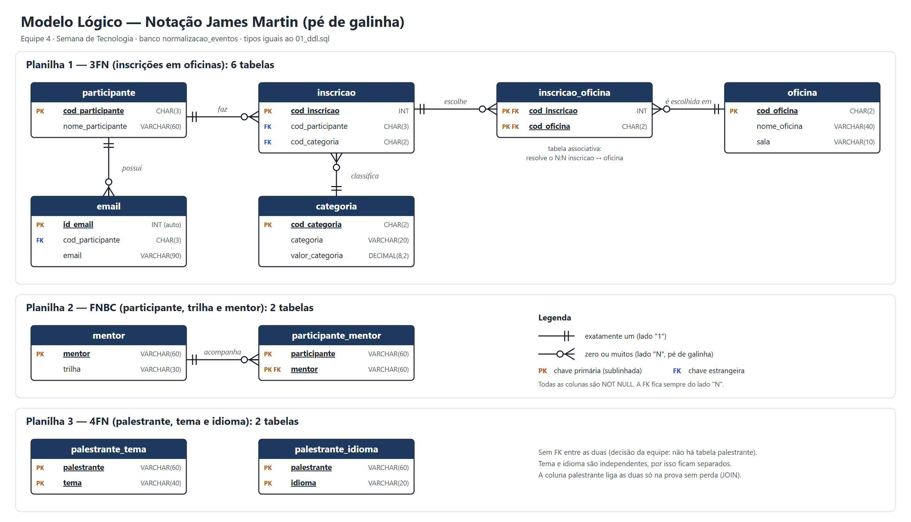

# Equipe 4: Semana de Tecnologia

**Nome do time:** ____________________

| Nome              | Usuário do GitHub |
| ---               | ---               |    
| Clecio Júnior     | @cleciofjur       |
| Denys Kauã        | @                 |
| Eluana Ferreira   | @                 |
| João Vitor        | @                 |
| Marcos Vínicius   | @mrvinicius25     |
| Raymond Barbosa   | @RaymondLima      | 
| Taís Yasmin       | @TaisSouz23       |

---

## O cenário

O sistema da Semana de Tecnologia hoje é uma planilha. Rode o `00_planilha.sql` no MySQL: ele cria o banco `normalizacao_eventos` com 3 tabelas que reproduzem a planilha (também em `planilha.xlsx`).

| Tabela | O que guarda |
| --- | --- |
| `planilha` | Cada linha é uma oficina escolhida em uma inscrição. Cada inscrição é de um participante e tem uma categoria de preço. |
| `planilha_fnbc` | Regra: em cada trilha, o participante tem um único mentor; cada mentor acompanha uma única trilha. |
| `planilha_4fn` | Cada palestrante fala sobre vários temas e em vários idiomas, sem relação entre tema e idioma. |


## 1. Anomalias


| Anomalia | Exemplo na planilha |
| --- | --- |
| Inserção | Não é possível cadastrar uma nova oficina sem associá-la a uma inscrição de um participante, sem deixar campos vazios ou utilizar dados fictícios. Isso ocorre porque os dados das oficinas e das inscrições estão armazenados na mesma tabela.  |
| Exclusão | Caso sejam excluídos todos os registros da oficina O2, associados às inscrições de Hugo Santos e Caio Pinto, também serão perdidas as informações sobre a existência dessa oficina e sua localização (Lab 2).  |
| Modificação | Caso o valor da categoria K1 (Estudante) seja alterado de R$ 50,00 para R$ 60,00, será necessário atualizar quatro registros, referentes às inscrições de Rita Gomes e Bia Moraes. Se algum registro não for atualizado, haverá inconsistência nos valores da mesma categoria. |

As três anomalias são consequências da redundância de dados e do armazenamento de informações sobre participantes, inscrições, categorias e oficinas em uma única tabela. A normalização permite separar essas informações em tabelas relacionadas, garantindo maior integridade e consistência dos dados.

## 2. Dependências funcionais da `planilha`

| Determinante       | Determina                   | Tipo (total, parcial ou transitiva) |
|     ---            |    ---                      |               ---                   |
|cod_inscricao       |cod_participante             |Parcial                              |
|cod_inscricao       |cod_categoria                |Parcial                              |
|cod_participante    |nome_participante, emails    |Transitiva                           |
|cod_categoria       |categoria, valor_categoria   |Transitiva                           |
|cod_oficina         |nome_oficina, sala           |Parcial                              |

**Chave primária da `planilha`:** [`cod_inscricao`, `cod_oficina`]

Justificativa:

1. `cod_inscricao` não é único, porque uma inscrição pode conter várias oficinas.
2. `cod_oficina` não é único, porque uma oficina pode estar associada a várias inscrições.
3. A combinação de ambos identifica unicamente cada registro da planilha, considerando que uma oficina não pode se repetir na mesma inscrição.

## 3. Normalização passo a passo

**1FN:** O atributo emails não era atômico, pois armazenava múltiplos endereços de e-mail em um único campo, separados por ponto e vírgula, como nos registros de Rita Gomes e Caio Pinto. Para atender à 1FN, os e-mails foram separados em uma tabela denominada participante_email, na qual cada registro armazena um único endereço de e-mail associado ao código do participante.

**2FN:** Foram identificadas dependências parciais em relação à chave primária composta (cod_inscricao, cod_oficina). Os dados da inscrição dependiam apenas de cod_inscricao, enquanto o nome e a sala da oficina dependiam apenas de cod_oficina. Para eliminar essas dependências, foram criadas as tabelas inscricao e oficina, além da tabela associativa inscricao_oficina, responsável por relacionar as inscrições às oficinas.

**3FN:** Foram identificadas dependências transitivas, pois nome_participante dependia de cod_participante, enquanto categoria e valor_categoria dependiam de cod_categoria. Para eliminar essas dependências, foram criadas as tabelas participante e categoria, mantendo na tabela inscricao apenas as respectivas chaves estrangeiras.

**Esquema final em 3FN:**

* participante (`cod_participante`, `nome_participante`)
* participante_email (`cod_participante`, `email`), FK: `cod_participante`.
* categoria (`cod_categoria`, `categoria`, `valor_categoria`)
* oficina (`cod_oficina`, `nome_oficina`, `sala`)
* inscricao (`cod_inscricao`, `cod_participante`, `cod_categoria`), FKs: `cod_participante` e `cod_categoria`.
* inscricao_oficina (`cod_inscricao`, `cod_oficina`), FKs: `cod_inscricao` e `cod_oficina`.

## 4. FNBC: `planilha_fnbc`

<!-- BLOCO: PLANILHA 2 (FNBC) - Pessoa 5 (Denys) -->
Planilha original (7 linhas):

| participante | trilha | mentor |
| --- | --- | --- |
| Rita Gomes | Back-end | Leo |
| Rita Gomes | Dados | Mara |
| Hugo Santos | Back-end | Davi |
| Hugo Santos | Front-end | Íris |
| Bia Moraes | Dados | Mara |
| Caio Pinto | Front-end | Íris |
| Caio Pinto | Back-end | Leo |

Regras do enunciado: em cada trilha o participante tem um único mentor, e cada mentor acompanha uma única trilha. Por isso Rita, Hugo e Caio aparecem com dois mentores (um por trilha). A trilha de cada mentor se repete: Leo → Back-end (2 linhas), Mara → Dados (2 linhas) e Íris → Front-end (2 linhas).

Anomalias:

| Anomalia | Exemplo na `planilha_fnbc` |
| --- | --- |
| Inserção | Não dá para cadastrar um mentor novo com a sua trilha antes de ele ter um participante, porque cada linha exige um participante. |
| Exclusão | Davi aparece em uma única linha (Hugo, Back-end). Se ela for apagada, perde-se a informação de que Davi existe e acompanha Back-end. |
| Modificação | Para a Mara passar a acompanhar outra trilha, é preciso alterar as 2 linhas dela (Rita e Bia). Alterar só uma deixa a Mara com duas trilhas e quebra a regra. |

- Chaves candidatas: `(participante, trilha)` e `(participante, mentor)`. Elas se sobrepõem no atributo `participante`. A segunda é chave porque `mentor → trilha`.
- Dependência que viola a FNBC: `mentor → trilha` (a outra dependência é `(participante, trilha) → mentor`). O determinante `mentor` não é chave da planilha. A 3FN tolera isso porque `trilha` faz parte da chave `(participante, trilha)`, mas a FNBC exige que todo determinante seja chave.
- Decomposição: a trilha vai para a tabela `mentor`, e a ligação entre participante e mentor fica em `participante_mentor`. A ligação precisa de tabela própria porque cada participante tem mais de um mentor.
- Limitação: depois da decomposição, nenhuma chave impede ligar o mesmo participante a dois mentores da mesma trilha (por exemplo, Hugo com Davi e com Leo, ambos de Back-end). Conferimos isso com uma consulta de validação no `03_prova_sem_perda.sql`.

| Tabela | Colunas | Chave primária | Linhas |
| --- | --- | --- | --- |
| `mentor` | mentor, trilha | mentor | 4 |
| `participante_mentor` | participante, mentor | (participante, mentor) | 7 |

Agora a trilha de cada mentor aparece uma só vez: para mudar a trilha da Mara, é preciso alterar só 1 linha, em `mentor`. A prova sem perda (`03_prova_sem_perda.sql`) remonta a planilha com `participante_mentor` JOIN `mentor`: 7 linhas originais, 7 reconstruídas, 0 faltando e 0 sobrando.
<!-- FIM DO BLOCO: PLANILHA 2 (FNBC) -->

## 5. 4FN: `planilha_4fn`

<!-- BLOCO: PLANILHA 3 (4FN) - Pessoa 6 (Tais) -->
**Planilha original (8 linhas):**

| palestrante | tema | idioma |
| --- | --- | --- |
| Dra. Lia | IA | Português |
| Dra. Lia | IA | Inglês |
| Dra. Lia | Ética | Português |
| Dra. Lia | Ética | Inglês |
| Prof. Rui | Cloud | Português |
| Prof. Rui | Cloud | Espanhol |
| Eng. Tais | Segurança | Português |
| Eng. Tais | Redes | Português |

A chave da planilha é (palestrante, tema, idioma), ou seja, as três colunas juntas.

**Anomalias:**

| Anomalia | Exemplo na `planilha_4fn` |
| --- | --- |
| Inserção | Para acrescentar o idioma Espanhol à Dra. Lia, é preciso inserir 2 linhas (uma para IA e outra para Ética). Se esquecer uma, a planilha passa a dizer que ela fala Espanhol em só um dos temas. |
| Exclusão | Para remover o idioma Inglês da Dra. Lia, é preciso apagar 2 linhas, uma em cada tema. Apagar só uma deixa os dados inconsistentes. |
| Modificação | Para trocar o nome do tema Ética, é preciso alterar todas as linhas em que ele aparece (2 linhas só da Dra. Lia). |

- Dependências multivaloradas: `palestrante ->> tema` e `palestrante ->> idioma`. Cada palestrante tem um **conjunto** de temas e, de forma independente, um **conjunto** de idiomas. O idioma não depende do tema, e o tema não depende do idioma. Como o palestrante não é chave da planilha, essas dependências violam a 4FN. A planilha já está na FNBC, porque não há dependência funcional cujo determinante não seja chave. O problema é só a multivalorada, e a Dra. Lia mostra isso: 2 temas x 2 idiomas = 4 linhas.
- Decomposição: cada conjunto independente vai para a sua própria tabela, ligadas pela coluna `palestrante` (decisão da equipe: 2 tabelas, sem tabela `palestrante` separada, que não é necessária para atingir a 4FN).

| Tabela | Colunas | Chave primária | Linhas |
| --- | --- | --- | --- |
| `palestrante_tema` | palestrante, tema | (palestrante, tema) | 5 |
| `palestrante_idioma` | palestrante, idioma | (palestrante, idioma) | 5 |

Agora, para acrescentar um idioma à Dra. Lia, é preciso inserir só **1 linha**, em `palestrante_idioma`.
<!-- FIM DO BLOCO: PLANILHA 3 (4FN) -->

## 6. Modelagem

### 6.1 Modelo conceitual (Peter Chen)

[Entidades, atributos (identificador sublinhado; multivalorado com elipse dupla), relacionamentos com nome e cardinalidade (mín, máx).]


### 6.2 Modelo lógico (James Martin, pé de galinha)

<!-- BLOCO: MODELO LOGICO - Pessoa 2 (Vitor) -->
O modelo lógico mostra as 10 tabelas finais com colunas, tipos, PK e FK, separadas pelas 3 planilhas. Na notação James Martin, a ponta com duas barras (`||`) é o lado "exatamente um" e a ponta com bolinha e pé de galinha (`o<`) é o lado "zero ou muitos". A FK fica sempre na tabela do lado "muitos".

| Planilha | Relacionamento | Cardinalidade | FK |
| --- | --- | --- | --- |
| 3FN | `participante` possui `email` | 1:N | `email.cod_participante` |
| 3FN | `participante` faz `inscricao` | 1:N | `inscricao.cod_participante` |
| 3FN | `categoria` classifica `inscricao` | 1:N | `inscricao.cod_categoria` |
| 3FN | `inscricao` escolhe `oficina` (via `inscricao_oficina`) | N:N | `inscricao_oficina.cod_inscricao` e `inscricao_oficina.cod_oficina` |
| FNBC | `mentor` acompanha `participante_mentor` | 1:N | `participante_mentor.mentor` |
| 4FN | `palestrante_tema` e `palestrante_idioma` | sem FK | as duas tabelas se ligam pela coluna `palestrante` só na prova sem perda |

O N:N entre inscrição e oficina não existe como linha direta no modelo lógico: ele vira a tabela associativa `inscricao_oficina`, com PK composta pelas duas FKs. Na 4FN não há tabela `palestrante` (decisão da equipe), por isso as duas tabelas não têm FK entre si.


<!-- FIM DO BLOCO: MODELO LOGICO -->

## 7. Dicionário de dados

Preencha o arquivo [`dicionario_dados.md`](dicionario_dados.md) com **todas** as tabelas finais.

## 8. Prova de junção sem perda

[Cole aqui o resultado do `03_prova_sem_perda.sql`: para cada planilha, linhas da original, linhas da reconstruída, faltando = 0 e sobrando = 0.]

```
(cole o resultado das demais planilhas)
```

<!-- BLOCO: PLANILHA 3 (4FN) - Pessoa 6 (Tais) -->
**Planilha 3 (4FN):** `planilha_4fn` x JOIN de `palestrante_tema` com `palestrante_idioma`

```
linhas_originais | linhas_reconstruidas | faltando | sobrando
8                | 8                    | 0        | 0
```
<!-- FIM DO BLOCO: PLANILHA 3 (4FN) -->

## 9. Desafio: uma decomposição errada

[Mostre uma decomposição da `planilha_fnbc` que **perde** informação: as duas tabelas, a consulta de junção e quantas linhas falsas (tuplas espúrias) ela gera.]
